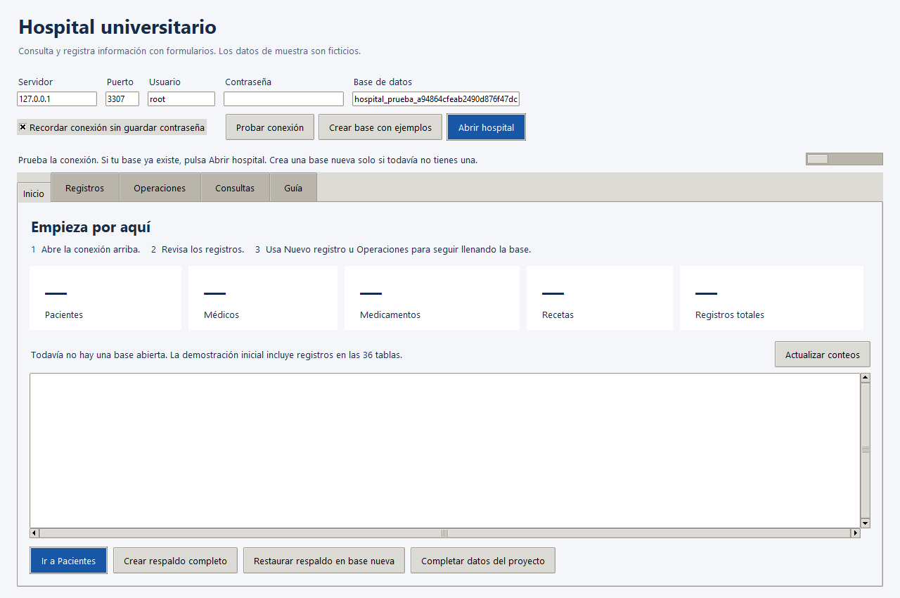
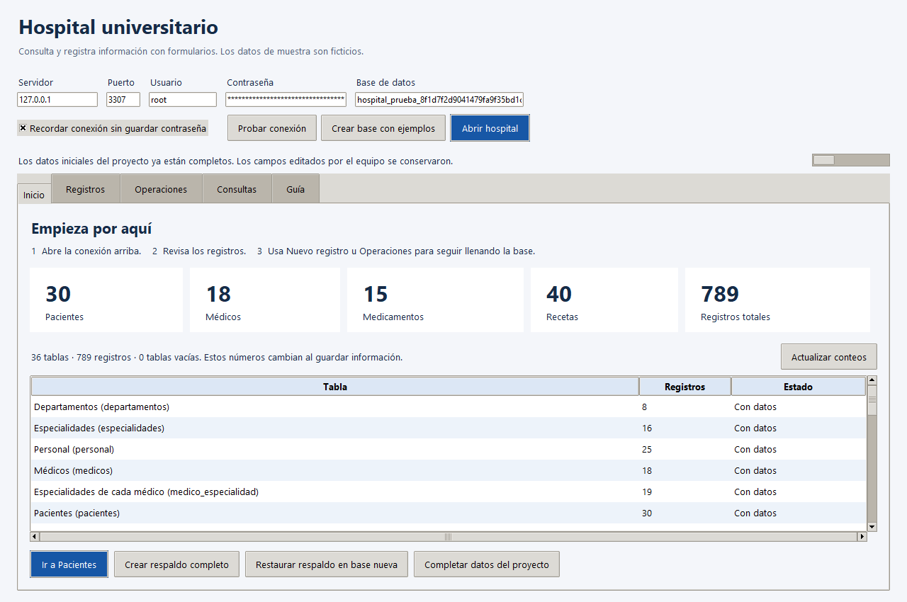
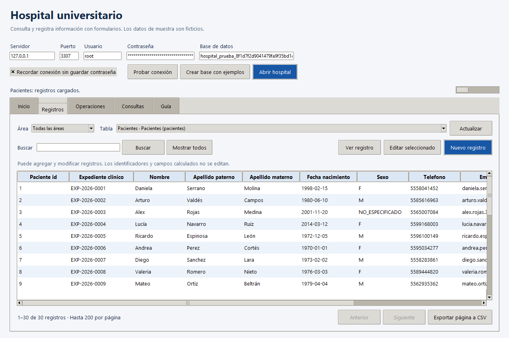
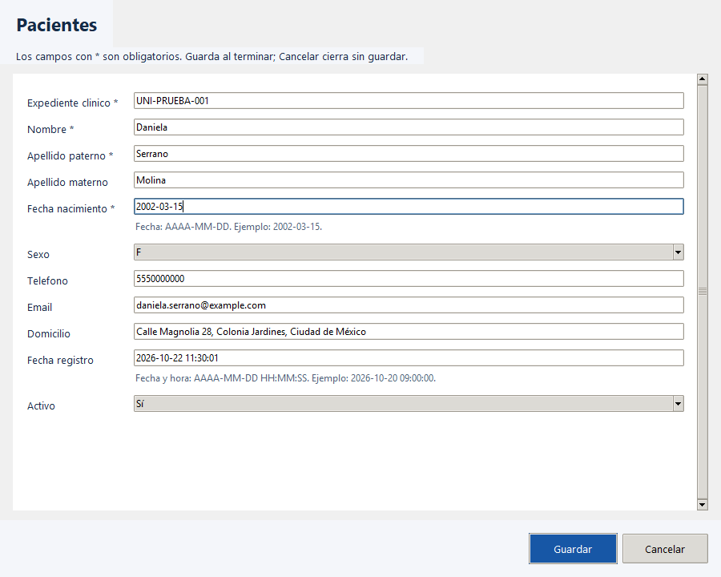
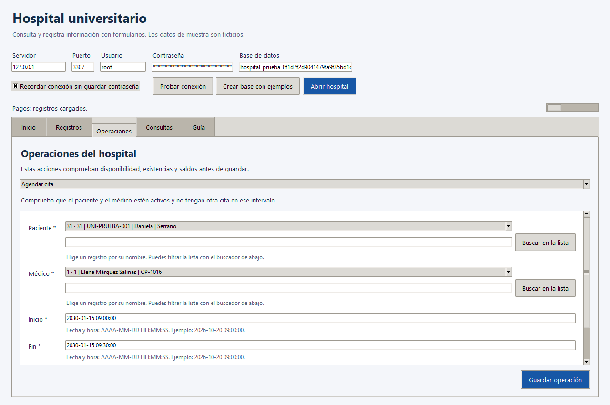
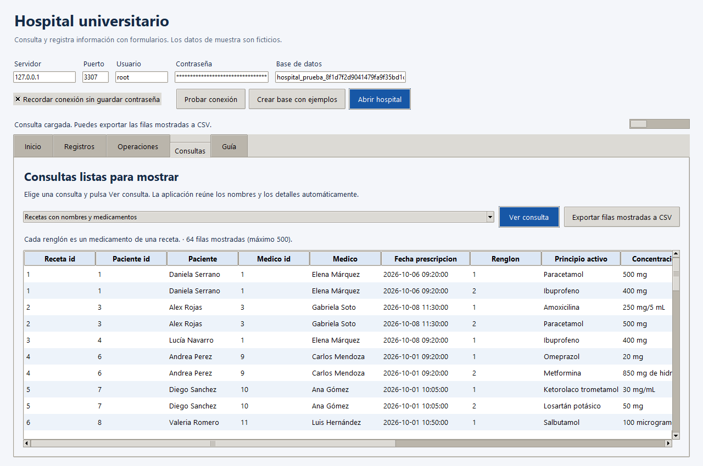

# Cómo usar la aplicación del hospital desde cero

Esta guía enseña a abrir la aplicación de Python, conectarla con tu base MySQL y trabajar mediante botones y formularios. Está escrita para alguien que nunca ha usado estas herramientas. Puedes registrar pacientes, citas, recetas y cobros de práctica sin escribir instrucciones SQL.

La aplicación es un programa de escritorio hecho en Python. MySQL guarda la información y la aplicación presenta las pantallas para consultarla y modificarla. Ambos deben estar disponibles en la computadora donde harás la demostración.

## Ruta para la primera vez

1. Descarga y extrae toda la carpeta del proyecto.
2. Instala Python y MySQL Server si todavía no los tienes.
3. Abre `ABRIR_HOSPITAL.bat` desde la carpeta extraída.
4. Escribe los datos de tu servidor y pulsa **Probar conexión**.
5. Lee el resultado. Si ya existe una base compatible, consérvala. Si todavía no existe, pulsa **Crear base con ejemplos**.
6. Pulsa **Abrir hospital**.
7. Revisa los registros y practica el alta de un paciente ficticio.

Si el proyecto ya abre y muestra registros, empieza directamente en la parte de uso de la aplicación. La creación de la base se hace una sola vez.

## Qué necesitas y qué es cada cosa

| Elemento | Para qué sirve |
| --- | --- |
| Carpeta del proyecto | Contiene la aplicación, sus instrucciones y la demostración. Conserva juntos todos sus archivos. |
| Python | Ejecuta la aplicación y dibuja sus ventanas. |
| MySQL Server | Guarda los pacientes, recetas y demás datos. Debe estar encendido. |
| Interfaz del hospital | Permite usar la base mediante campos, listas y botones. |
| PDF o tutorial de texto | Explica los pasos actuales. Abrirlo no ejecuta la aplicación. |
| GitHub | Guarda los archivos del equipo. Su contraseña no es la contraseña del servidor MySQL. |

## Descargar y extraer el proyecto

1. Entra al repositorio del equipo en GitHub con tu cuenta, si te pide iniciar sesión.
2. Pulsa **Code** y luego **Download ZIP**.
3. Abre la carpeta Descargas de Windows y localiza el archivo ZIP que descargaste.
4. Haz clic derecho en el ZIP y elige **Extraer todo**. Pulsa **Extraer**.
5. Abre la carpeta extraída. Si dentro hay otra carpeta con el nombre del repositorio, ábrela también.
6. Detente cuando veas `ABRIR_HOSPITAL.bat` junto con la carpeta `app_hospital`.

**Resultado esperado:** puedes ver el iniciador y la carpeta de la aplicación en el Explorador de archivos. No abras el iniciador desde la vista interna del ZIP. Extraer todo permite que el programa encuentre sus demás archivos.

Conserva esta carpeta en un lugar fácil de encontrar, por ejemplo Documentos. No necesitas abrir cada archivo `.py` ni los archivos `.sql`.

El [repositorio del equipo](https://github.com/Spidey123134/hospital-universitario) es público: puedes descargarlo sin iniciar sesión. Para subir cambios al código necesitas una cuenta de GitHub con permiso de colaboración. Si no encuentras la página, revisa la dirección o pide al equipo el ZIP completo.

## Instalar Python

Si Python ya está instalado y el iniciador abre la aplicación, salta este apartado. Para Windows utiliza una instalación normal de Python 3.12 o 3.13 con Tcl/Tk, pip y el lanzador de Python. La instalación incluida en el proyecto no descarga MySQL Server.

1. Abre [Descargas de Python para Windows](https://www.python.org/downloads/windows/).
2. Para seguir la ruta del instalador tradicional, entra a una versión de la serie 3.13 y busca **Windows installer 64 bit** para una computadora común de 64 bits. El sitio también ofrece Python Install Manager; si utilizas ese administrador, completa su instalación y la instalación de Python antes de volver al proyecto.
3. Ejecuta el instalador. Deja instalados pip, Tcl/Tk y el lanzador. Si aparece **Add python.exe to PATH**, márcalo.
4. Completa la instalación y vuelve a la carpeta del proyecto.
5. Haz doble clic en `ABRIR_HOSPITAL.bat`.

**Resultado esperado:** se abre una ventana de preparación y después la ventana del hospital. La primera ejecución puede tardar porque prepara el entorno e instala el conector de MySQL. Necesita internet en ese momento.

La documentación oficial describe el instalador y sus opciones: [Python en Windows](https://docs.python.org/3.13/using/windows.html). No elijas un archivo de código fuente ni el paquete embebible para este ejercicio.

## Instalar o localizar MySQL Server

Si ya tienes un servidor MySQL funcionando, conserva ese servidor y usa sus datos. Instalar únicamente Workbench no instala necesariamente el servicio que guarda los datos.

**En la laptop donde se creó el proyecto:** ya se preparó un MySQL local. Abre `F:\Base de Datos\mysql_local\INICIAR_BASE_LOCAL.bat` y espera el mensaje de inicio. Los datos de conexión están en `F:\Base de Datos\mysql_local\CONEXION_PRIVADA.txt`. Usa servidor `127.0.0.1`, puerto `3307` y base `hospital_universitario`. Esa contraseña es privada de esa computadora; el archivo no está en GitHub y no se comparte con los compañeros.

**En la computadora de cada compañero:** utiliza su propia instalación de MySQL y la contraseña que él o ella configuró. El puerto suele ser `3306`. Cada persona tendrá su copia independiente del hospital. Descargar el proyecto no instala automáticamente MySQL Server.

Para una instalación nueva en Windows:

1. Abre [MySQL Community Server](https://dev.mysql.com/downloads/mysql/) y selecciona la serie **8.4 LTS** y Windows.
2. Descarga el paquete **MSI Installer** y ejecútalo.
3. Al terminar la instalación, completa **MySQL Configurator**.
4. Elige una configuración de desarrollo para tu computadora. Mantén TCP/IP y anota el puerto que muestre; normalmente es **3306**.
5. Define la contraseña del usuario **root** y guárdala. Tú eliges esa contraseña; el proyecto no trae una contraseña universal.
6. Deja configurado el servidor como servicio de Windows y aplica los cambios. El asistente debe terminar sin errores.

**Resultado esperado:** MySQL Server está iniciado y conoces su usuario, contraseña y puerto. No necesitas Workbench para usar la aplicación del hospital.

Si el profesor o un compañero ya configuró el servidor, pídele esos tres datos y la dirección del servidor. Si usas un servidor en otra computadora, `localhost` no apunta a ella: apunta a tu propia computadora.

Fuentes oficiales: [paquetes para Windows](https://dev.mysql.com/doc/refman/8.4/en/windows-choosing-package.html) y [configuración del servidor](https://dev.mysql.com/doc/refman/8.4/en/mysql-configurator-workflow-server.html).

## Abrir el proyecto en los siguientes días

1. Comprueba que MySQL Server esté iniciado.
2. Abre la carpeta extraída del proyecto.
3. Haz doble clic en `ABRIR_HOSPITAL.bat`.
4. Espera a que aparezca la ventana de conexión.
5. Completa los datos y abre el hospital existente.

Cerrar la ventana del hospital no borra los registros. Los datos se guardan en MySQL, no dentro del PDF ni en las filas que ves en pantalla. Volver a descargar el ZIP tampoco copia los cambios de otra computadora; para trasladarlos se necesita una copia de la base.

## Conectar la aplicación con MySQL

Completa los campos de la ventana de conexión con los valores de tu instalación:

| Campo | Ejemplo para un servidor en tu computadora |
| --- | --- |
| Servidor | `127.0.0.1` o `localhost` |
| Puerto | `3306` en una instalación habitual; `3307` en la laptop del proyecto |
| Usuario | `root` o el usuario que te proporcionaron |
| Contraseña | La que definiste al configurar MySQL |
| Base de datos | `hospital_universitario` |

Pulsa **Probar conexión** antes de crear o abrir la base. Este botón revisa el servidor y la estructura de la base elegida; no instala, rellena ni cambia registros. Lee el resultado completo:

- **Base compatible:** el servidor responde y la estructura corresponde al proyecto. Pulsa **Abrir hospital** para usar los datos que ya tiene.
- **Base inexistente:** la conexión al servidor funciona, pero todavía no existe una base con ese nombre. Puedes crearla con **Crear base con ejemplos**.
- **Base incompatible o incompleta:** ese nombre existe, pero su estructura no coincide con la del proyecto. Conserva sus datos y pide revisión al equipo, o utiliza otro nombre para una práctica nueva.
- **Error de conexión:** revisa servidor, puerto, usuario y contraseña antes de continuar.

La contraseña de GitHub, Windows o correo no sustituye la contraseña de MySQL. Los registros de la tabla `usuarios` son parte del modelo y no son las credenciales de conexión al servidor.

Si la cuenta que te dieron solo tiene permisos de consulta, podrás abrir el hospital, buscar y ver registros. Los botones para escribir se deshabilitan. Para registrar o modificar información se necesita una cuenta MySQL con esos permisos; marcar un campo en la aplicación no cambia los permisos del servidor.

Las imágenes muestran la aplicación real durante una prueba. Pueden mostrar un puerto o una base temporal distintos de los tuyos. Copia tus propios datos de conexión, no los valores de las capturas. La contraseña no se muestra; escribe la de tu instalación de MySQL.

## Crear la base con ejemplos una sola vez

Si es la primera instalación y todavía no existe `hospital_universitario`:

1. Prueba la conexión hasta que funcione.
2. Revisa el nombre de la base.
3. Pulsa **Crear base con ejemplos** y acepta la confirmación de creación.
4. Espera a que termine. No cierres la ventana durante el proceso.
5. Pulsa **Abrir hospital**.

**Resultado esperado:** la aplicación muestra el hospital con 36 tablas y 789 filas en total, incluidas 30 personas en pacientes, 18 médicos, 15 medicamentos y 40 recetas. La copia nueva ya incluye los textos completos: nombres, domicilios, notas, catálogo de medicamentos, recetas y estudios. También conserva 95 teléfonos de diez dígitos y 59 correos personalizados bajo `example.com`.

Esos números describen la carga inicial. Cambiarán cuando el equipo agregue sus registros. Todas las tablas contienen ejemplos; cada tabla tiene la cantidad que corresponde a sus relaciones. Una receta puede tener varios renglones de medicamentos.

Los contactos son inventados para el proyecto. Un correo guardado en la tabla no crea una cuenta de correo, y un teléfono inventado no está verificado como libre. Los datos clínicos sirven para comprobar relaciones y formularios; no son indicaciones de tratamiento.

Si la base ya existe, utiliza **Abrir hospital**. No necesitas borrar una base para entrar a la aplicación ni repetir la creación cada día. Conserva el trabajo que ya haya agregado tu equipo.

## Actualizar una copia que todavía tiene textos de relleno

Si al abrir tablas aparecen valores como «domicilio ficticio» o «dosis simulada», estás usando datos de una versión anterior. Descargar los archivos nuevos no cambia automáticamente los registros guardados en MySQL.

1. Abre la versión actual de la aplicación y entra a tu hospital existente.
2. Pulsa **Inicio → Completar datos del proyecto**.
3. Revisa el mensaje y la ubicación donde se guardará el respaldo previo.
4. Confirma la actualización y espera a que termine. Si no se puede guardar el respaldo, la aplicación no debe comenzar a cambiar los datos.
5. Lee el resumen y vuelve a abrir las tablas en **Registros**. Comprueba domicilios, medicamentos, notas y recetas.

La revisión abarca 19 tablas con textos anteriores y comprueba los campos de texto de las 36 tablas. Cambia solamente valores conocidos de versiones previas y conserva los campos que tu equipo ya modificó. No vuelve a crear la base, no agrega otra copia de las filas y no borra el trabajo. El archivo 07 de contactos queda como antecedente histórico; no tienes que ejecutarlo para usar este botón.

## Ideas que te ayudarán al llenar formularios

**Fila o registro:** una entrada guardada. Un paciente es un registro de `pacientes`.

**Columna o campo:** un dato del registro, como nombre, fecha de nacimiento o teléfono.

**Identificador:** número que distingue un registro de otro. Si el formulario lo genera automáticamente, no lo escribas.

**Relación:** vínculo entre registros. Para una cita eliges un paciente y un médico que ya existen.

**Guardar:** envía los cambios a MySQL. Escribir en un campo sin guardar todavía no crea el registro.

**Actualizar:** vuelve a leer los datos guardados para mostrarlos en la pantalla.

**Obligatorio y opcional:** los campos obligatorios deben tener un valor válido. Un campo opcional puede quedar sin valor cuando no conoces el dato; no escribas la palabra `NULL` para representar un campo vacío.

## Reconocer las cinco pestañas

| Pestaña | Cuándo la usas |
| --- | --- |
| Inicio | Comprobar los conteos y ver si las 36 tablas tienen registros. |
| Registros | Ver tablas, buscar y agregar datos mediante formularios. |
| Operaciones | Agendar citas, asignar camillas, entregar medicamentos y registrar cobros con sus reglas. |
| Consultas | Ver información reunida con nombres, existencias o saldos. |
| Guía | Consultar ayuda y abrir el PDF o el tutorial de texto actualizado. |

Empieza en **Inicio**. Una base recién creada contiene 30 pacientes y 18 médicos. Si un compañero ya agregó algo, el número puede ser mayor. Busca el resumen de las 36 tablas para comprobar que la demostración está cargada.

## Ver y buscar pacientes

1. Pulsa **Registros**.
2. En **Área**, elige **Pacientes** para acortar la lista de tablas. Después, en **Tabla**, elige **Pacientes (pacientes)**. También puedes conservar **Todas las áreas** y buscar allí la tabla.
3. Mira las filas del centro. Cada fila es un paciente y cada columna es un dato suyo.
4. Si una columna queda fuera de la ventana, utiliza la barra de desplazamiento horizontal inferior. Para leer todos los campos en una ventana, selecciona una fila y pulsa **Ver registro**.
5. En **Buscar**, escribe una parte del nombre o del expediente. Pulsa el botón **Buscar**.
6. Para quitar el filtro, pulsa **Mostrar todos**.

**Resultado esperado:** ves pacientes guardados en MySQL. Buscar filtra lo que se muestra; no elimina filas. Si no aparecen resultados, quita el filtro y revisa la escritura.

El selector **Área** organiza las tablas por la parte del hospital a la que pertenecen. Cambiar el área solo cambia las opciones de la lista; no mueve ni elimina datos. El nombre entre paréntesis identifica la tabla para el equipo y no tienes que escribirlo como código.

La aplicación muestra hasta 200 filas por página. **Anterior** y **Siguiente** sirven para recorrer páginas cuando hay más registros. **Actualizar** vuelve a leer los datos del servidor.

Seleccionar una fila significa hacer un clic sobre ella para resaltarla. No basta con colocar el ratón encima.

## Registrar tu primer paciente

Vamos a crear un paciente ficticio para practicar. No cambies la tabla a otra mientras sigues este ejercicio.

1. En **Registros**, selecciona **Pacientes (pacientes)**.
2. Pulsa **Nuevo registro**. Se abre una ventana de formulario.
3. Escribe los datos de la siguiente tabla. Los campos con asterisco son obligatorios; algunos tienen un valor predeterminado.

| Dato | Valor de práctica |
| --- | --- |
| Expediente clínico | `UNI-PRUEBA-001` |
| Nombre | `Daniela` |
| Apellido paterno | `Serrano` |
| Apellido materno | `Molina` |
| Fecha de nacimiento | `2004-05-20` |
| Sexo | Selecciona `F` en la lista |
| Teléfono | `5500000099` |
| Email | `daniela.serrano.clase@example.com` |
| Domicilio | `Calle Magnolia 28, Colonia Jardines, Ciudad de México` |
| Activo | Selecciona **Sí** |

4. Si la fecha de registro ya tiene un valor, consérvalo. Si el campo está vacío y permite el valor predeterminado, déjalo así: MySQL pondrá la fecha de registro al guardar.
5. No inventes el identificador automático del paciente. El programa lo obtiene al guardar.
6. Pulsa **Guardar** una sola vez y espera el mensaje de éxito.
7. En la tabla, busca `UNI-PRUEBA-001`.

**Resultado esperado:** aparece una fila con Daniela y un identificador. Si partiste de los 30 pacientes de la demostración, ahora tendrás 31.

Si no ves los campos de abajo, desplázate dentro del formulario con la rueda del ratón o la barra vertical derecha. Los botones **Guardar** y **Cancelar** están al pie de la ventana.

Los campos como **Activo** se eligen con **Sí** o **No**. El programa convierte esa elección al valor que guarda MySQL. Al guardar también revisa el formato de las fechas, los números y el largo permitido de los textos; si hay un error, corrige el campo indicado y vuelve a guardar.

La imagen ilustra dónde se escribe y dónde se guarda. Para seguir el ejercicio utiliza los valores de la tabla anterior; el formulario fotografiado contiene algunos valores de prueba distintos.

Si aparece expediente repetido, busca primero ese expediente: tal vez el paciente ya se guardó. Para un segundo ejercicio usa `UNI-PRUEBA-002`. No pulses Guardar repetidamente para intentar quitar el mensaje.

Si te arrepientes antes de guardar, pulsa **Cancelar**. La ventana se cierra sin crear el paciente.

## Corregir un dato guardado

1. En **Pacientes**, busca `UNI-PRUEBA-001`.
2. Haz un clic en la fila de Daniela para seleccionarla.
3. Pulsa **Editar seleccionado**. El doble clic abre **Ver registro**, que sirve para leer todos los campos; para cambiar datos utiliza el botón de edición.
4. Cambia el teléfono por `5500000088`.
5. Pulsa **Guardar**.
6. Revisa la columna del teléfono. Puedes pulsar **Actualizar** para volver a leerla.

**Resultado esperado:** sigue existiendo el mismo paciente, con el mismo identificador y el teléfono corregido. Editar no crea otra persona.

Algunas tablas guardan historia y permiten agregar, pero no editar registros anteriores. Otras se trabajan desde **Operaciones**. Lee el aviso situado junto a la tabla. **Ver registro** permite leer los campos aunque no se autorice editarlos; cierra esa ventana para volver a la lista. Los botones deshabilitados indican que esa acción no corresponde a esa tabla.

Para dejar de utilizar un paciente o empleado cuando proceda, cambia su campo **activo** mediante el formulario. Las referencias históricas deben conservarse; el programa no ofrece borrar indiscriminadamente todos los registros.

## Agregar un contacto y entender las listas

Un contacto de emergencia pertenece a un paciente que ya está registrado. Lo seleccionaremos por su nombre y expediente.

1. En **Registros**, cambia **Tabla** a **Contactos de emergencia (contactos_emergencia)**.
2. Pulsa **Nuevo registro**.
3. Abre la lista de **Paciente** y elige a Daniela, identificándola por su nombre o expediente `UNI-PRUEBA-001`. La opción también muestra su identificador.
4. Escribe nombre `Rosa Molina Campos`, parentesco `Madre`, teléfono `5500000077` y prioridad `1`.
5. Pulsa **Guardar**.

**Resultado esperado:** se guarda un contacto vinculado con Daniela. No necesitas escribir un número de paciente de memoria.

Si la lista es muy grande, usa **Buscar en la lista** cuando el formulario lo ofrezca. Si no encuentras al paciente, revisa que ya lo hayas guardado y vuelve a abrir el formulario. Un texto escrito en una lista no crea por sí solo un paciente nuevo.

En las fechas escribe año, mes y día: `2004-05-20`. Para fecha y hora usa `2026-11-02 10:00:00`. La hora utiliza 24 horas; las tres de la tarde se escriben `15:00:00`.

## Agregar médicos y otros datos del equipo

Los 36 tipos de registros ya tienen ejemplos. Si el profesor pide más información, agreguen casos relacionados y comprueben el resultado. No es necesario escribir datos sin sentido en cada tabla para aumentar sus conteos.

Para un médico nuevo, el orden es:

1. En **Registros**, elige **Personal (personal)** y pulsa **Nuevo registro**. Completa un número de empleado único, un departamento, el nombre y apellidos. Selecciona puesto **MEDICO** y conserva el valor activo. Guarda y anota el identificador.
2. Cambia a **Médicos (medicos)**, pulsa **Nuevo registro** y selecciona el empleado que acabas de registrar. Escribe una cédula ficticia única, por ejemplo `CEDULA-UNI-001`, y guarda.
3. Cambia a **Especialidades de cada médico (medico_especialidad)** y agrega el vínculo entre ese médico y una especialidad existente.
4. En **Consultas**, abre **Médicos y especialidades** para comprobar que aparece con su nombre completo.

Las listas indican qué registro previo se necesita. Estos son otros órdenes de trabajo frecuentes:

| Para agregar | Primero debe existir |
| --- | --- |
| Contacto de emergencia o póliza | Paciente; para una póliza, también aseguradora |
| Camilla | Habitación |
| Lote de medicamento | Medicamento y proveedor |
| Receta y sus renglones | Consulta; después receta y medicamento |
| Resultado de estudio | Orden del estudio |
| Concepto o pago de factura | Factura; para el pago, factura emitida |

Si falta la opción que necesitas en una lista, guarda primero ese registro de origen. Las tablas de acceso del modelo se consultan en esta versión; no crean una pantalla de inicio de sesión para empleados.

## Agendar una cita desde Operaciones

Este ejemplo usa una fecha de práctica. Si el equipo ya ocupó ese horario, elige otro intervalo libre.

1. Pulsa **Operaciones** y elige **Agendar cita**.
2. En **Paciente**, selecciona a Daniela por el expediente `UNI-PRUEBA-001`.
3. En **Médico**, elige un médico activo de la lista y anota cuál elegiste.
4. En **Inicio**, escribe `2026-11-02 10:00:00`.
5. En **Fin**, escribe `2026-11-02 10:30:00`.
6. En **Motivo**, escribe `Revisión de control`.
7. Pulsa **Guardar operación**.
8. En **Registros**, selecciona **Citas (citas)** y localiza la cita recién creada. Anota su identificador.

**Resultado esperado:** una cita PROGRAMADA para el paciente y médico seleccionados. El sistema rechaza horarios que se solapen con otra cita del mismo paciente o médico.

Al guardar una operación se solicita confirmación. Revisa que sea la base correcta y pulsa **Sí** para completar esa operación.

Para confirmarla, vuelve a **Operaciones**, elige **Confirmar cita**, selecciona la cita correcta y pulsa **Guardar operación**. Si se cancela, utiliza **Cancelar cita**. Cancelar conserva la historia; no significa borrar la fila.

La captura usa una fecha de ensayo de 2030. Para el ejercicio de esta guía usa el 2 de noviembre de 2026 indicado en los pasos, u otro intervalo libre que acuerde el equipo.

## Registrar una consulta y su receta

Una cita reserva un horario. Una consulta registra la atención. Una receta se vincula con una consulta y después recibe sus renglones de medicamentos.

1. En **Registros**, elige **Consultas (consultas)** y pulsa **Nuevo registro**.
2. Para practicar sin vincular la cita anterior, selecciona a Daniela y un médico activo, deja la cita opcional vacía y elige tipo **URGENCIA**. Usa motivo `Valoración por congestión nasal` y fecha `2026-11-02 11:00:00`. Deja vacíos los datos opcionales que no utilizarás.
3. Pulsa **Guardar**. Localiza la consulta y anota su identificador.
4. Cambia a **Recetas (recetas)**, pulsa **Nuevo registro** y selecciona esa consulta. Usa fecha `2026-11-02 11:05:00` y observación `Seguimiento en consulta externa`. Guarda y anota el identificador de la receta.
5. Cambia a **Medicamentos de cada receta (receta_detalle)** y pulsa **Nuevo registro**.
6. Selecciona la receta que acabas de crear y **Loratadina, 10 mg, tableta** del catálogo. Para practicar la captura, escribe renglón `1`, dosis `1 tableta`, frecuencia `Cada 24 horas`, duración `1`, vía `Oral` y cantidad prescrita `1`. Guarda.
7. Abre **Consultas**, elige **Recetas con nombres y medicamentos** y pulsa **Ver consulta**.

**Resultado esperado:** ves el paciente, médico y medicamento juntos. Una receta con dos medicamentos produce dos renglones con el mismo identificador de receta. Es la forma de guardar varios medicamentos sin duplicar la cabecera.

Los textos anteriores sirven para comprobar los formularios de un proyecto de Sistemas. No representan un tratamiento.

## Entregar un medicamento y revisar existencias

Recetar no descuenta existencias. La salida de farmacia ocurre al entregar un medicamento.

1. En **Consultas**, abre **Medicamentos pendientes de entregar**. Localiza una receta con cantidad pendiente mayor que cero y anota receta, renglón y medicamento.
2. Abre **Existencias por lote**. Localiza un lote del mismo medicamento, con existencias suficientes y fecha de caducidad posterior a la entrega. Anota ese lote.
3. En **Operaciones**, elige **Entregar medicamento de receta**.
4. Selecciona la receta y el lote correctos. Escribe el renglón que anotaste, cantidad `1`, un empleado de **FARMACIA** y una fecha de entrega posterior a la prescripción y anterior a la caducidad del lote.
5. Pulsa **Guardar operación**.
6. Vuelve a las dos consultas y pulsa **Ver consulta** para actualizarlas.

**Resultado esperado:** el pendiente de esa receta disminuye en una unidad y las existencias del lote también. La aplicación registra la entrega y su movimiento en la misma operación.

Si se rechaza, revisa el mensaje. No cambies directamente la cantidad del inventario para forzar la entrega. Las entradas o ajustes se registran mediante **Registrar entrada o ajuste de inventario**, con su fecha, empleado y motivo.

## Crear una factura y registrar un pago

1. En **Registros**, elige **Facturas (facturas)** y pulsa **Nuevo registro**.
2. Escribe folio `UNI-COBRO-001`, selecciona a Daniela y usa fecha `2026-11-02 12:00:00`. Deja la póliza opcional vacía para este ejemplo. Guarda.
3. Cambia a **Conceptos de facturas (factura_detalle)**. Crea un concepto para esa factura con renglón `1`, descripción `Consulta de medicina general`, cantidad `1`, precio unitario `100.00` y descuento `0.00`. Guarda.
4. En **Operaciones**, elige **Emitir factura**, selecciona la factura de ese folio y pulsa **Guardar operación**.
5. En **Consultas**, abre **Facturas y saldos** y pulsa **Ver consulta**. La factura debe mostrar total `100.00` y saldo `100.00`.
6. En **Operaciones**, elige **Registrar pago de factura**. Selecciona esa factura, escribe fecha `2026-11-02 12:10:00`, monto `40.00` y método **EFECTIVO**. Guarda la operación.
7. Actualiza **Facturas y saldos**.

**Resultado esperado:** el total sigue en `100.00`, los pagos suman `40.00` y el saldo es `60.00`. Puedes abonar después sin superar ese saldo.

Los conceptos se modifican mientras la factura está ABIERTA. Emitirla cierra esa etapa. **Anular factura sin pagos** conserva la factura con estado ANULADA y exige que no tenga pagos.

## Registrar una estancia y asignar camilla

1. En **Registros**, elige **Hospitalizaciones (hospitalizaciones)** y pulsa **Nuevo registro**.
2. Selecciona una consulta de ingreso y el mismo paciente de esa consulta. Para practicar puedes usar la consulta de Daniela creada antes. Selecciona un médico responsable, ingreso `2026-11-02 11:30:00` y motivo `Observación y seguimiento`. Guarda.
3. En **Consultas**, abre **Disponibilidad de camillas**. Identifica una camilla disponible y operativa.
4. En **Operaciones**, elige **Asignar o trasladar camilla**. Selecciona la hospitalización que acabas de crear, esa camilla e inicio `2026-11-02 11:35:00`. Guarda.
5. Actualiza **Disponibilidad de camillas**. Debe aparecer ocupada.
6. Para terminar el ejemplo, en **Operaciones** elige **Dar alta hospitalaria**. Selecciona esa estancia, fecha `2026-11-02 13:00:00` y resumen `Alta con seguimiento en consulta externa`. Guarda.

**Resultado esperado:** la hospitalización conserva ingreso y alta, y la camilla queda libre. Si hay notas o traslados posteriores, el alta debe tener una fecha posterior a ellos.

Un paciente no puede tener dos hospitalizaciones abiertas a la vez. Una camilla ocupada o en mantenimiento no debe asignarse. Usa la consulta de disponibilidad antes de cada asignación.

## Ver resultados reunidos y exportar una tabla

En **Consultas** no se escriben instrucciones: se elige un resultado preparado y se pulsa **Ver consulta**. Prueba **Médicos y especialidades**, **Recetas con nombres y medicamentos** y **Facturas y saldos**.

Para guardar lo que estás revisando:

1. Abre una tabla en **Registros** o un resultado en **Consultas**.
2. Si estás buscando un conjunto concreto, aplica primero el filtro correspondiente.
3. En Registros pulsa **Exportar página a CSV**. En Consultas el botón se llama **Exportar filas mostradas a CSV**. Elige una carpeta, escribe un nombre y guarda.
4. Abre el archivo con una hoja de cálculo o un editor de texto.

**Resultado esperado:** un archivo con las columnas y los registros de la página visible. En **Registros** hay hasta 200 filas por página y en **Consultas** hasta 500. Un CSV no conserva por sí solo las 36 tablas, sus relaciones, rutinas y reglas. Para trasladar toda la base utiliza el respaldo completo.

## Guardar un respaldo completo

Un respaldo permite trasladar los datos de todas las tablas. Guardar el PDF, copiar el ZIP de código o exportar un CSV de pacientes no guarda todo lo que el equipo ha registrado en MySQL.

1. Abre el hospital y comprueba que estás conectado a la base que quieres copiar.
2. En **Inicio**, pulsa **Crear respaldo completo**.
3. Elige una carpeta y un nombre fácil de reconocer, por ejemplo `hospital_equipo_2026-11-02.hospital.json`.
4. Pulsa Guardar en el diálogo de archivos y espera la confirmación.
5. Comprueba que el archivo existe en la carpeta que elegiste y guarda una segunda copia en otra ubicación.

**Resultado esperado:** un archivo terminado en `.hospital.json` con los datos de las 36 tablas. El archivo no incluye la contraseña de conexión. Conserva también la aplicación del proyecto: la restauración utiliza su estructura y reglas.

Haz una copia antes de una práctica de todo el equipo y otra después de terminar los cambios que presentarán.

## Recuperar el respaldo en otra base

La recuperación crea una base nueva y conserva la base anterior. Para probar la copia en la misma computadora, usa un nombre nuevo como `hospital_copia_equipo`.

1. Conserva el respaldo `.hospital.json` y toda la carpeta de la aplicación.
2. Comprueba que MySQL Server esté iniciado y que la conexión tenga permiso para crear bases. Puedes seguir conectado al hospital original.
3. En **Inicio**, pulsa **Restaurar respaldo en base nueva** y elige el archivo `.hospital.json` que guardaste.
4. Cuando el programa pregunte el nombre de destino, escribe `hospital_copia_equipo`, u otro nombre que todavía no exista. No cambies el campo superior de conexión para preparar la restauración.
5. Revisa el nombre de la nueva base, confirma la creación y espera a que termine.
6. Al terminar, el programa coloca el nombre de la copia nueva en la conexión. Pulsa **Abrir hospital** para revisarla. En **Inicio**, compara los conteos y busca el expediente `UNI-PRUEBA-001` si estaba incluido en el respaldo.

**Resultado esperado:** una base nueva con los datos que existían al crear el respaldo. Si después agregaste más pacientes al original, no aparecerán en una copia anterior.

Si el nombre de destino ya existe, el programa lo rechaza. Elige otro nombre nuevo; no borres la base del equipo para restaurar una prueba.

El respaldo se recupera desde el botón de la aplicación. Dar doble clic en el archivo JSON puede abrir un editor de texto, pero eso no restaura la base.

## Solucionar los problemas más comunes

**No aparece ABRIR HOSPITAL.** Abre la carpeta interior del repositorio y comprueba que extrajiste todo el ZIP. El archivo puede verse como `ABRIR_HOSPITAL` si Windows oculta las extensiones.

**El iniciador dice que falta Python.** Instala Python, cierra la ventana del iniciador y vuelve a abrirla. Instalar un editor de código no instala necesariamente Python.

**No se puede instalar el conector.** Revisa internet y el mensaje de la ventana de preparación. Vuelve a abrir el iniciador después de resolver la conexión. Conserva el mensaje completo para quien mantiene el proyecto.

**No conecta o aparece error 2003.** Comprueba que MySQL Server esté iniciado, que el servidor sea correcto y que usas su puerto TCP/IP. Para una instalación local normal suele ser 3306. El MySQL preparado en esta laptop usa 3307 y se inicia desde `mysql_local\INICIAR_BASE_LOCAL.bat`; no cambies entre ambos puertos al azar.

Si instalaste MySQL como servicio de Windows, abre Inicio, busca **Servicios** y abre esa herramienta. Localiza el servicio que configuraste, por ejemplo **MySQL80** o **MySQL84**. Si está detenido, haz clic derecho y selecciona **Iniciar**; Windows puede solicitar una cuenta con permiso de administrador. Vuelve después a **Probar conexión**. Consulta la [documentación oficial del servicio MySQL](https://dev.mysql.com/doc/refman/8.0/en/windows-start-service.html) para esta forma de inicio.

**Acceso denegado o error 1045.** Revisa usuario y contraseña de MySQL. La aplicación no puede adivinar ni recuperar la contraseña que se configuró en ese servidor.

**La base ya existe.** Pulsa Probar conexión y, si es compatible, Abrir hospital. No repitas Crear base con ejemplos ni borres la base que está usando el equipo.

**La base existe pero faltan tablas.** Puede tratarse de otra base con el mismo nombre o de una instalación incompleta. Conserva el mensaje y solicita revisión; no mezcles a ciegas instaladores distintos sobre los datos del equipo.

**Lista vacía o registro no encontrado.** Pulsa Mostrar todos o Actualizar. Comprueba que estás en la tabla y base correctas. Si buscas una relación, primero debe existir el registro de origen.

**Expediente o folio repetido.** Busca el valor antes de volver a guardar. Si ya existe, edita ese registro cuando corresponda o utiliza un valor nuevo para un ejercicio distinto.

**Fecha inválida.** Usa `AAAA-MM-DD`, por ejemplo `2004-05-20`. Si pide hora, agrega espacio y `HH:MM:SS` en formato de 24 horas.

**Operación rechazada por una regla.** Lee el motivo y corrige ese dato: horario ocupado, lote incorrecto, cantidad mayor al pendiente, camilla ocupada o pago mayor al saldo. No es necesario escribir SQL para resolverlo.

## Dónde se guarda el trabajo del equipo

El código y los documentos se comparten mediante la carpeta o GitHub. Los cambios realizados en los formularios quedan en el servidor MySQL al que te conectaste. Si dos personas usan servidores distintos, cada una tiene su propia copia de los datos.

En este proyecto se eligió una copia en cada computadora. Cada integrante instala su base y usa su propia contraseña de MySQL. Para pasar a otra computadora el trabajo realizado, guarda un respaldo completo, compártelo con tu compañero y restáuralo allí con un nombre nuevo. La restauración conserva los datos que ya tenga esa otra computadora en su base anterior. Exportar una sola tabla a CSV ayuda a revisar información, pero no reemplaza el respaldo completo.

## Antes de presentar al profesor

1. Prueba el proyecto en la computadora de la presentación.
2. Verifica que MySQL esté iniciado y que conozcas la contraseña.
3. Abre el hospital y confirma que aparecen pacientes, médicos y recetas.
4. Prepara un paciente ficticio distinto para la demostración.
5. Guarda una copia antes de que todo el equipo practique cambios.

Puedes explicar: “Esta aplicación está programada en Python. Los botones envían operaciones a MySQL. La base tiene 36 tablas relacionadas y ya viene con ejemplos. Registraremos un paciente desde un formulario y veremos el registro guardado”.

No utilices pacientes reales. Los nombres, recetas y demás datos del proyecto son ejemplos para una entrega de Sistemas.

## Para quienes desarrollan el proyecto

El usuario de la aplicación trabaja con formularios. Quien programa mantiene el código de `app_hospital`, los scripts del modelo y las pruebas. La documentación técnica y el tutorial de Workbench se conservan para esa tarea. La guía actual corresponde al uso de las ventanas de Python.
